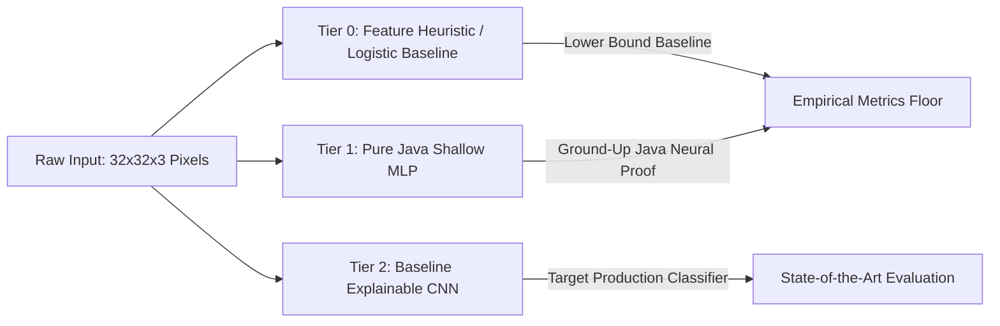

# Baseline Model & CNN Architecture Plan

**Project:** Traffic Sign Recognition and Road Safety Monitor  
**Course:** Deep Learning (CSAI3027P)  
**Status:** Architecture & Evaluation Protocol Specification (Stage 1)  

> [!IMPORTANT]
> **No Metrics Claimed Notice:** At this stage, no neural network weights have been trained, and no experimental metrics are fabricated or claimed. This document specifies the planned baseline models, architectures, evaluation criteria, and execution strategies.

---

## 1. Two-Tier Baseline Strategy

To provide an empirical progression, the project establishes two distinct baseline tiers before evaluating modern deep architectures:

### Tier 0: Pure Java Logistic / Color-Spatial Baseline
* **Purpose:** Establishes the absolute performance floor. Proves whether a non-deep linear model can separate sign categories using flattened raw pixels or color histogram features.
* **Input:** Flattened vector of 3072 features ($32 \times 32 \times 3$).
* **Mechanism:** Softmax regression / single affine transformation:
  $$\hat{y} = \text{Softmax}(W x + b), \quad W \in \mathbb{R}^{43 \times 3072}$$
* **Hypothesis:** Linear models will struggle severely on fine-grained distinctions (e.g., distinguishing "Speed limit 30" vs. "Speed limit 80"), highlighting the need for hierarchical spatial features learned by CNNs.

### Tier 1: Pure Java Shallow MLP
* **Purpose:** Implemented entirely in Java without external libraries to fulfill the neural network fundamentals requirements (Stage 2).
* **Architecture:**
  * Input layer: $3072$ nodes.
  * Hidden Layer 1: $256$ nodes (ReLU activation, Xavier initialization).
  * Hidden Layer 2: $128$ nodes (ReLU activation).
  * Output Layer: $43$ nodes (Softmax activation).
* **Loss & Optimizer:** Categorical Cross-Entropy, trained using Mini-batch SGD with Momentum.

### Tier 2: Baseline Explainable Convolutional Neural Network (CNN)
* **Purpose:** The core computer-vision model designed to exploit 2D spatial correlations.
* **Input:** Tensor $[3, 32, 32]$ normalized to $[0.0, 1.0]$.
* **Target Architecture (Lightweight Modular GTSRB CNN):**
  1. **Conv2D-1:** 32 filters, kernel $3 \times 3$, stride 1, padding 'same', BatchNorm, ReLU, MaxPool $2 \times 2 \rightarrow$ Output $[32, 16, 16]$.
  2. **Conv2D-2:** 64 filters, kernel $3 \times 3$, stride 1, padding 'same', BatchNorm, ReLU, MaxPool $2 \times 2 \rightarrow$ Output $[64, 8, 8]$.
  3. **Conv2D-3:** 128 filters, kernel $3 \times 3$, stride 1, padding 'same', BatchNorm, ReLU, MaxPool $2 \times 2 \rightarrow$ Output $[128, 4, 4]$.
  4. **Batch Flatten:** $\rightarrow 2048$ features ($128 \times 4 \times 4$).
  5. **Dropout-1:** Rate $0.40$ (regularization).
  6. **Dense-1:** 256 nodes, ReLU activation.
  7. **Dropout-2:** Rate $0.30$.
  8. **Dense-Output:** 43 nodes, Softmax activation.
* **Total Trainable Parameters:** Exactly **629,739 parameters** (verified via `GtsrbCnnBlock.countParameters`, strictly satisfying the 0.3M–1.0M budget). See `docs/DJL_TRAINING_ENGINE.md` for layer-by-layer parameter derivation.

---

## 2. Evaluation Protocol & Metrics Matrix

All models will be evaluated exclusively on the held-out test split generated by `DatasetSplitter` (which guarantees zero track leakage):

| Metric | Mathematical Definition | Why It Matters for Road Safety |
| :--- | :--- | :--- |
| **Top-1 Accuracy** | $\frac{\sum_{i=1}^N \mathbb{I}(\hat{y}_i = y_i)}{N}$ | Overall classification correctness. |
| **Per-Class Precision** | $\frac{TP_c}{TP_c + FP_c}$ | When the system alerts the driver of a "Stop" sign, how often is it truly a Stop sign? |
| **Per-Class Recall** | $\frac{TP_c}{TP_c + FN_c}$ | Out of all physical Stop signs encountered, how many were correctly detected? |
| **Macro-Averaged F1** | $\frac{1}{C} \sum_{c=1}^C 2 \cdot \frac{P_c \cdot R_c}{P_c + R_c}$ | **Primary benchmark metric.** Treats rare warning classes equally with high-frequency speed limits. |
| **Confusion Matrix** | $43 \times 43$ integer matrix | Identifies specific visual confusions (e.g., circular red speed limits confused with one another). |
| **Inference Latency** | Mean, p50, p95, p99 over 1,000 runs in ms | Verifies real-time viability on standard CPU hardware. |

---

## 3. Implementation Options & Faculty Approval Decisions

### Training Strategy: 100% Java-Only Training via Deep Java Library (DJL)

* **Architecture Decision:** The project strictly adopts a **Java-only training and inference architecture** using Deep Java Library (`ai.djl:api:0.28.0` and `ai.djl.pytorch:pytorch-engine:0.28.0`).
* **No Python Dependency:**
  * No Python scripts, environments, or interpreters are used for any part of the dataset preparation, training orchestration, checkpointing, or evaluation.
  * All training loops, forward passes, autograd backpropagation, optimizer updates, and metric calculations execute directly inside Java 21 via `com.trafficsign.neural.djl.CnnTrainer`.
  * The PyTorch engine in DJL communicates with LibTorch C++ native binaries via JNI; it does **not** launch or require Python.
* **Benefits:** Full academic compliance with the course's C/C++/Java mandate, high-performance training orchestration, and zero external language dependencies.
