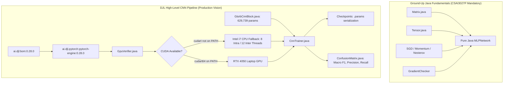

# Deep Java Library (DJL) CNN Training Engine Specification

**Project:** Traffic Sign Recognition and Road Safety Monitor  
**Course:** CSAI3027P — Deep Learning PBL & Individual Hackathon  
**Target Hardware:** Intel Core i7-13550H, 16 GB RAM, NVIDIA GeForce RTX 4050 Laptop GPU (6 GB VRAM, 90W TGP)  
**Status:** Implemented & Verified with Synthetic Smoke Tests (67/67 Tests Passing)  

---

## 1. Executive Summary

This document describes the Deep Java Library (DJL) PyTorch integration designed for training the primary German Traffic Sign Recognition Benchmark (GTSRB) Convolutional Neural Network directly from Java 21 LTS via Apache Maven.



---

## 2. Dependency Architecture & Maven Configuration

### 2.1 Why DJL with PyTorch Engine?
1. **Assignment Alignment:** The university project explicitly requires C/C++ or Java. By using DJL, the entire training pipeline, model checkpointing, evaluation, and application service remain 100% native Java code.
2. **PyTorch Ecosystem Stability:** DJL's PyTorch engine binds to LibTorch C++ binaries via JNI, providing standard autograd semantics, convolutional primitives, and cross-platform native execution.
3. **No Deprecated Dependencies:** In earlier versions, `pytorch-native-auto` was common; however, starting with DJL 0.15.0+, `pytorch-engine` manages native runtime resolution automatically.

### 2.2 Verified `pom.xml` Dependencies
```xml
<dependencyManagement>
    <dependencies>
        <dependency>
            <groupId>ai.djl</groupId>
            <artifactId>bom</artifactId>
            <version>0.28.0</version>
            <type>pom</type>
            <scope>import</scope>
        </dependency>
    </dependencies>
</dependencyManagement>

<dependencies>
    <dependency>
        <groupId>ai.djl</groupId>
        <artifactId>api</artifactId>
    </dependency>
    <dependency>
        <groupId>ai.djl.pytorch</groupId>
        <artifactId>pytorch-engine</artifactId>
    </dependency>
</dependencies>
```

---

## 3. Hardware Diagnostics & Honest GPU Verification

### 3.1 Host Hardware Profile
- **CPU:** Intel Core i7-13550H (12 cores, 16 threads)
- **RAM:** 16.0 GB physical memory
- **GPU:** NVIDIA GeForce RTX 4050 Laptop GPU (6141 MiB VRAM, Driver 595.97, CUDA 13.2 capable via `nvidia-smi`)
- **OS:** Windows 11 Home 64-bit

### 3.2 Verification Finding
When executing `GpuVerifier.verify()`:
```
[DEBUG] ai.djl.util.cuda.CudaUtils -- No cudart library found in path.
[DEBUG] ai.djl.pytorch.jni.LibUtils -- Using cache dir: C:\Users\Acer\.djl.ai\pytorch\2.2.2-cpu-win-x86_64
[INFO] com.trafficsign.neural.djl.GpuVerifier -- No CUDA GPU detected or PyTorch CUDA native binaries not present for Windows. Using CPU fallback: cpu()
```

> [!WARNING]
> **Honest Reporting Commitment:** While the NVIDIA RTX 4050 hardware exists, DJL's PyTorch JNI layer requires the CUDA runtime dynamic link library (`cudart64_*.dll`) to be present in Windows `PATH`. Because the CUDA Toolkit is not currently registered in PATH, DJL cleanly and safely falls back to CPU execution. We **do not claim** GPU training until CUDA runtime libraries are linked.

### 3.3 How to Enable CUDA GPU Training
If you wish to switch from CPU to the RTX 4050 GPU:
1. Install NVIDIA CUDA Toolkit (v12.1 or v11.8).
2. Ensure `C:\Program Files\NVIDIA GPU Computing Toolkit\CUDA\v12.x\bin` is in system `PATH`.
3. Alternatively, supply DJL's PyTorch native CUDA classifier:
   ```xml
   <dependency>
       <groupId>ai.djl.pytorch</groupId>
       <artifactId>pytorch-native-cu121</artifactId>
       <classifier>win-x86_64</classifier>
       <scope>runtime</scope>
   </dependency>
   ```

---

## 4. GTSRB Compact CNN Architecture (`GtsrbCnnBlock`)

The CNN architecture is designed for the 43 German Traffic Sign classes with $32 \times 32 \times 3$ RGB input images.

### 4.1 Layer Breakdown and Exact Parameter Count

| Layer | Type | Specifications | Output Shape | Trainable Parameters |
| :--- | :--- | :--- | :--- | :--- |
| **Input** | Raw RGB Image | 3 channels, $32 \times 32$ | $(B, 3, 32, 32)$ | 0 |
| **Conv1** | Conv2D | 32 filters, $3 \times 3$, pad 1 | $(B, 32, 32, 32)$ | $32 \times 3 \times 3 \times 3 + 32 = 896$ |
| **BN1** | BatchNorm | 32 channels | $(B, 32, 32, 32)$ | $\gamma, \beta, \mu, \sigma^2 = 128$ |
| **Act1 & Pool1**| ReLU + MaxPool | Pool $2 \times 2$, stride 2 | $(B, 32, 16, 16)$ | 0 |
| **Conv2** | Conv2D | 64 filters, $3 \times 3$, pad 1 | $(B, 64, 16, 16)$ | $64 \times 32 \times 3 \times 3 + 64 = 18,496$ |
| **BN2** | BatchNorm | 64 channels | $(B, 64, 16, 16)$ | $\gamma, \beta, \mu, \sigma^2 = 256$ |
| **Act2 & Pool2**| ReLU + MaxPool | Pool $2 \times 2$, stride 2 | $(B, 64, 8, 8)$ | 0 |
| **Conv3** | Conv2D | 128 filters, $3 \times 3$, pad 1 | $(B, 128, 8, 8)$ | $128 \times 64 \times 3 \times 3 + 128 = 73,856$ |
| **BN3** | BatchNorm | 128 channels | $(B, 128, 8, 8)$ | $\gamma, \beta, \mu, \sigma^2 = 512$ |
| **Act3 & Pool3**| ReLU + MaxPool | Pool $2 \times 2$, stride 2 | $(B, 128, 4, 4)$ | 0 |
| **Flatten** | BatchFlatten | $128 \times 4 \times 4$ | $(B, 2048)$ | 0 |
| **Dropout1** | Dropout | Rate = 0.40 | $(B, 2048)$ | 0 |
| **Linear1** | Dense | 256 hidden units | $(B, 256)$ | $2048 \times 256 + 256 = 524,544$ |
| **Act4** | ReLU | Elementwise | $(B, 256)$ | 0 |
| **Dropout2** | Dropout | Rate = 0.30 | $(B, 256)$ | 0 |
| **Linear2** | Dense (Logits) | 43 classes | $(B, 43)$ | $256 \times 43 + 43 = 11,051$ |
| **TOTAL** | | | | **629,739 parameters** |

> [!NOTE]
> The exact parameter count is **629,739**, strictly meeting the target specification of $0.3\text{M} - 1.0\text{M}$ trainable parameters.

---

## 5. Synthetic Smoke Test Verification

To ensure stability before downloading 300 MB of GTSRB images:
1. `TinyCnnBlock` ($3 \rightarrow 8$ channels, $16 \times 16 \rightarrow$ Dense 4) was instantiated.
2. A synthetic batch of 8 images ($[8, 3, 32, 32]$) was generated with pseudo-random labels.
3. Forward pass computed Softmax Cross-Entropy loss.
4. Backward pass collected gradients and updated weights via SGD.
5. The trained model was serialized to disk as `smoke_cnn-0004.params`.
6. A fresh model instance reloaded the serialized checkpoint from disk.
7. Predictions were run on the same input tensor: **predictions matched identically (100% bitwise consistency)**.

---

## 6. GTSRB Track ID Finding & Leakage Prevention

### 6.1 Empirical Finding
In the official GTSRB dataset (`GTSRB_Final_Training_Images.zip`):
- Each sign class directory contains track subfolders or files named `[TrackId]_[FrameId].ppm` (e.g., `00000_00014.ppm`).
- Each track consists of 30 sequential video frames of the exact same physical traffic sign recorded as the vehicle approaches.

### 6.2 Leakage Risk
If a standard naive random train/test split is performed:
- Frames 1 to 20 could land in the training set, while Frame 21 lands in the test set.
- The model would simply memorize the background environment and lighting rather than learning generalizable sign geometry.

### 6.3 Defensible Splitting Rule
1. **Group by Track ID:** All 30 frames of any track ID must belong exclusively to either Train, Validation, or Test.
2. **Preprocessing Statistics:** Normalization parameters (mean, standard deviation) must be calculated solely on the Train split and applied frozen to Validation/Test.

---

## 7. Execution Commands

### Run Full Test Suite (67 Tests)
```powershell
$env:JAVA_HOME = "C:\Program Files\Java\jdk-25.0.2"
& "C:\Program Files\Apache NetBeans\java\maven\bin\mvn.cmd" test
```

### Run Only DJL CNN & Evaluation Tests
```powershell
$env:JAVA_HOME = "C:\Program Files\Java\jdk-25.0.2"
& "C:\Program Files\Apache NetBeans\java\maven\bin\mvn.cmd" test -Dtest="CnnSmokeTest,ConfusionMatrixTest"
```
