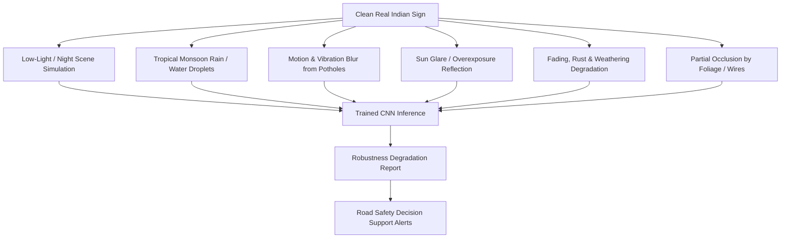

# Indian Road Deep Learning Experiment & Road Safety Protocol

**Project:** Indian Traffic Sign Recognition and Road Safety Monitor  
**Course:** CSAI3027P — Deep Learning PBL  
**Primary Target:** Java 21 LTS + Apache Maven  
**Engine:** Deep Java Library (DJL) 0.28.0 + PyTorch 2.2.2 Runtime  
**Hardware Profile:** Intel Core i7-13550H (12 cores, 16 threads), 16 GB RAM, NVIDIA RTX 4050 Laptop GPU (6 GB VRAM)  
**Date:** October 19, 2026  

---

## 1. Experimental Objectives and PBL Alignment

The objective of this experimental protocol is to train, evaluate, and benchmark deep learning models strictly on **Indian traffic sign imagery and Indian road conditions**. 

In adherence to academic PBL guidelines:
- No metrics are fabricated or assumed.
- Models progress from simple interpretable baselines to deep convolutional neural networks.
- All orchestration, data pipelines, and evaluation metrics are executed in pure Java 21.

### Task Definition Distinction
- **Stage 1 (Classification):** *"Which sign is this?"* Classifies a cropped sign ROI into one of the 85 IRC:67 classes.
- **Stage 2 (Detection & Localization):** *"Where is the sign in the road scene, and what is its category?"* Predicts bounding box $[x_1, y_1, x_2, y_2]$ and class probability.
- **Stage 3 (Road Safety Monitoring):** Translates recognized signs and their physical condition into driver-assist decision-support warnings (e.g. speed-breaker proximity alert, silence zone reminder, school zone speed limit warning).

---

## 2. Model Hierarchy and Comparative Architecture Plan

| Architecture | Implementation Subsystem | Input Resolution | Parameter Count (Est.) | Scientific Role |
| :--- | :--- | :---: | :---: | :--- |
| **Model 0: Interpretable Baseline** | Pure Java 21 Nearest Centroid / Logistic Linear | $32 \times 32 \times 3$ (Flattened 3072) | $\approx 2.6 \times 10^5$ | Minimum acceptable performance floor; benchmark for non-deep linear separability. |
| **Model 1: Multilayer Perceptron (MLP)** | Pure Java 21 (`MLPNetwork`) | $32 \times 32 \times 3$ (Flattened 3072) | $[3072, 256, 128, 85] \approx 8.3 \times 10^5$ | Mandatory course baseline proving fundamental neural mechanics (analytical backpropagation, cross-entropy, momentum). |
| **Model 2: Compact Indian CNN** | DJL / PyTorch (`IndianSignCnnBlock`) | $32 \times 32 \times 3$ or $48 \times 48 \times 3$ | $\approx 0.6 \text{M} - 1.2 \text{M}$ | Primary candidate; 3 Conv-BatchNorm-ReLU-MaxPool blocks with Dropout and dense classification head. |
| **Model 3: Lightweight Residual CNN (ResNet-style)** | DJL / PyTorch Sequential / Residual Blocks | $48 \times 48 \times 3$ or $64 \times 64 \times 3$ | $\approx 2.5 \text{M} - 4.0 \text{M}$ | Comparative deep architecture; skip connections evaluate gradient flow improvements on faded/degraded sign variants. |

---

## 3. Training Protocol and Hyperparameters

Training on the recommended primary dataset (`kannanwisen/Indian-Traffic-Sign-Classification`, ~5,726 images across 85 classes) will adhere to deterministic execution:

- **Data Split:** 70% Train (~4,008 samples), 15% Validation (~859 samples), 15% Held-out Test (~859 samples), partitioned using `GroupedDatasetSplitter` (seed `42L`).
- **Batch Size:** 64 (well within the 6 GB VRAM of the RTX 4050 and 16 GB host RAM).
- **Optimizer:** Adam ($\beta_1 = 0.9, \beta_2 = 0.999, \epsilon = 10^{-8}$) with initial learning rate $\eta = 0.001$.
- **Learning Rate Schedule:** Cosine Annealing or ReduceLROnPlateau (decay factor 0.5 upon validation loss stagnation for 3 consecutive epochs).
- **Regularization:** Weight decay $L_2 = 10^{-4}$, Spatial Dropout (0.25 after conv blocks), Dense Dropout (0.4 before classifier head).
- **Maximum Epochs:** 25 with early stopping patience of 5 epochs monitored on Validation Macro-F1.
- **Hardware Target:** PyTorch DJL Engine with automatic CUDA acceleration if native `cudart64` binaries are linked, or multi-threaded CPU fallback (8 intra-op / 12 inter-op threads).

---

## 4. Evaluation Metrics

Models will be evaluated across multidimensional performance criteria using our pure Java `ConfusionMatrix`:

1. **Overall Top-1 Accuracy:** $\frac{\sum \text{TP}_i}{N}$
2. **Macro-Averaged Precision:** $\frac{1}{C} \sum_{i=1}^C \text{Precision}_i$
3. **Macro-Averaged Recall:** $\frac{1}{C} \sum_{i=1}^C \text{Recall}_i$
4. **Macro-Averaged F1-Score:** $\frac{2 \cdot \text{MacroPrecision} \cdot \text{MacroRecall}}{\text{MacroPrecision} + \text{MacroRecall}}$ (accounts for rare class representation).
5. **Per-Class Support and Imbalance Sensitivity:** Monitored across all 85 classes via `ClassFrequencyReport`.
6. **Inference Latency:** Measured in milliseconds per sample (batch size = 1) averaged over 500 warmup runs.
7. **Model Footprint:** Memory usage (MB) and serialized parameter checkpoint size on disk.

For detection tasks (supplementary dataset):
- **Intersection over Union (IoU):** Evaluated via `BoundingBox.computeIoU()`.
- **Mean Average Precision (mAP@0.5 and mAP@0.5:0.95):** Localisation accuracy across bounding boxes.

---

## 5. Indian Road Robustness Evaluation Protocol

Real-world deployment across Indian highway corridors involves harsh environmental stressors. The robustness protocol systematically tests models against clean vs perturbed inputs:

### Specific Perturbation Tests

1. **Low-Light / Dusk Driving:** Brightness scale factor $\alpha \in [0.2, 0.5]$ and Poisson photon noise.
2. **Tropical Monsoon Simulation:** Synthetic rain streaks (angled directional lines) and Gaussian contrast degradation ($\sigma \in [1.0, 2.5]$).
3. **Vibration & Motion Blur:** Linear motion blur kernels (kernel size $k \in [3, 7]$, angle $\theta \in [0^\circ, 45^\circ]$) representing camera shake on uneven surfaces or speed breakers.
4. **Harsh Sun Glare:** Localized Gaussian brightness saturation spot mimicking high-intensity tropical reflection on retroreflective metal sheeting.
5. **Sign Degradation (Weathering & Rust):** Perlin noise overlay and color saturation loss representing oxidized and bleached boards.
6. **Partial Occlusion:** Cutout masking of 10% to 35% bounding box area simulating roadside foliage, hanging cables, or adjacent vehicle obstruction.

### Quantitative Degradation Metrics
For each perturbation severity level $s$:
$$\Delta F_1(s) = \text{Macro-F1}_{\text{clean}} - \text{Macro-F1}_{\text{perturbed}}(s)$$
A model with minimal $\Delta F_1(s)$ exhibits superior environmental invariance.

---

## 6. Road Safety Decision-Support Framework

The road safety monitoring subsystem uses model inferences strictly as **decision-support cues** to assist human drivers. It maps recognized signs into prioritized safety notifications:

1. **Speed Breaker Proximity Alert:** Triggered upon detection of `HUMP_OR_ROUGH_ROAD`. Prompts driver to decelerate to prevent suspension damage or rollover.
2. **Silence Zone Notice:** Triggered upon detection of `HORN_PROHIBITED`. Informs driver of hospital, school, or court vicinity.
3. **Livestock Hazard Warning:** Triggered upon detection of `CATTLE`. Advises heightened attention to road shoulders.
4. **Overtaking Prohibition:** Triggered upon detection of `OVERTAKING_PROHIBITED`. Warns driver against leaving the travel lane on undivided ghat roads.
5. **Ghat Road Acoustic Advisory:** Triggered upon detection of `COMPULSARY_SOUND_HORN`. Reminds driver to sound acoustic horn before blind hairpin bends.

### Safety Disclaimer & Ethical Boundary
> [!WARNING]
> This system is designed solely as an academic decision-support and driver-assistance demonstration. It is **NOT** a certified autonomous-driving, collision-avoidance, or life-critical safety system. Drivers retain full legal and operational responsibility for vehicle control at all times under the Indian Motor Vehicles Act.
