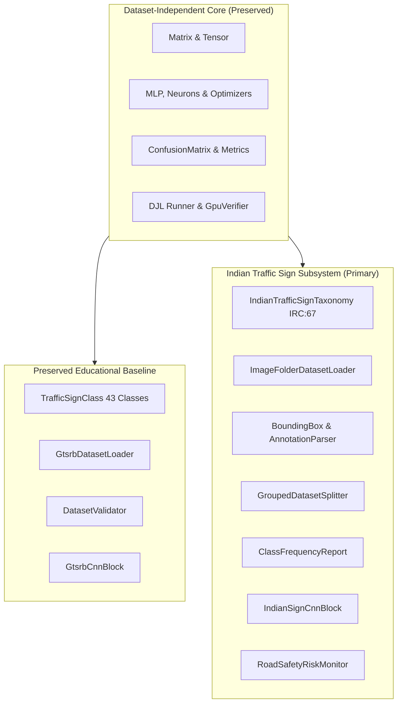

# Comprehensive Project Audit: Reorienting to Indian Roads, Traffic Signs, and Driving Conditions

**Project:** Indian Traffic Sign Recognition and Road Safety Monitor  
**Course:** CSAI3027P — Deep Learning PBL  
**Workspace:** `S:\TrafficSignRecognitionRoadSafetyMonitor`  
**Date of Audit:** October 19, 2026  
**Target Environment:** Java 21 LTS + Apache Maven  

---

## 1. Executive Summary

This audit evaluates the codebase to reorient the project from the German Traffic Sign Recognition Benchmark (GTSRB) to **Indian roads, Indian traffic signs, and Indian driving conditions**. 

The existing implementation possesses robust, high-integrity components:
- Pure Java 21 neural network fundamentals (Matrix, Tensor, McCulloch-Pitts & Sigmoid neurons, MLP with analytical backpropagation and numerical gradient checking, optimizers, learning rules, SVD demonstrator, Confusion Matrix).
- Deep Java Library (DJL) 0.28.0 integration with PyTorch 2.2.2 CPU/GPU verification pipeline.
- 74 automated unit and integration tests passing cleanly.

However, the initial dataset preparation was tightly coupled to GTSRB conventions:
- German 43-class taxonomy (`TrafficSignClass`).
- Semicolon-delimited GTSRB CSV formats (`GtsrbDatasetLoader`).
- Video track grouping derived strictly from GTSRB naming conventions (`00000_00014.ppm` -> `00000`).
- Hard-coded 43-class assumptions in model blocks (`GtsrbCnnBlock.DEFAULT_NUM_CLASSES = 43`) and dataset validator (`DatasetValidator.EXPECTED_CLASSES = 43`).
- PPM image format assumptions in downloaders and integration tests.

Rather than deleting working code or breaking educational baseline tests, the architecture is isolated: legacy GTSRB code is preserved as an educational baseline reference, while a dataset-independent abstraction layer and dedicated **Indian Traffic Sign Pipeline** are introduced.

---

## 2. Inventory of Existing Components

| Subsystem / Package | Key Classes | Status & Role |
| :--- | :--- | :--- |
| **`com.trafficsign.math`** | `Matrix`, `Tensor`, `GradientChecker`, `SvdDemonstrator` | **Retain as-is.** Pure linear algebra and gradient verification; 100% dataset-independent. |
| **`com.trafficsign.neural.neuron`** | `McCullochPittsNeuron`, `SigmoidNeuron` | **Retain as-is.** Biological and mathematical neuron foundations; dataset-independent. |
| **`com.trafficsign.neural.optimizer`** | `Optimizer`, `StochasticGradientDescent`, `MomentumOptimizer`, `NesterovOptimizer`, `BatchGradientDescent` | **Retain as-is.** First-order optimization algorithms; dataset-independent. |
| **`com.trafficsign.neural.activation`** | `ActivationFunction`, `ReLUActivation`, `SigmoidActivation`, `Softmax` | **Retain as-is.** Universal non-linearities; dataset-independent. |
| **`com.trafficsign.neural.loss`** | `CategoricalCrossEntropyLoss` | **Retain as-is.** Numerically stable multi-class loss with clipping; dataset-independent. |
| **`com.trafficsign.neural.rules`** | `HebbLearning`, `ErrorCorrectionLearning`, `CompetitiveLearning`, `HopfieldEnergyModel` | **Retain as-is.** Educational neural learning rule models; dataset-independent. |
| **`com.trafficsign.neural.mlp`** | `MLPNetwork`, `MLPDatasetIntegrationTest` | **Retain as-is.** Fully parameterized feed-forward architecture; layer dimensions are dynamic. |
| **`com.trafficsign.evaluation`** | `ConfusionMatrix` | **Retain as-is.** Multi-class accuracy, precision, recall, and macro-F1; constructor takes arbitrary `numClasses`. |
| **`com.trafficsign.neural.djl`** | `GpuVerifier`, `CnnTrainingConfig`, `CnnTrainer`, `TinyCnnBlock` | **Retain with minor parameterization.** Supports CPU fallback and PyTorch backend. |
| **`com.trafficsign.neural.djl`** | `GtsrbCnnBlock` | **Retain as legacy/baseline.** CNN parameterized by `int numClasses` (can be instantiated for Indian class count). |
| **`com.trafficsign.data`** | `TrafficSignClass` | **Isolate as German baseline.** Enum with 43 German/Vienna convention classes. |
| **`com.trafficsign.data`** | `ImageSample` | **Updated.** Generalize classId to arbitrary non-negative integer. |
| **`com.trafficsign.data`** | `ImagePreprocessor` | **Retain & Extend.** Already supports PPM, PNG, JPEG, bilinear resizing, and ROI cropping; extend to support configurable dataset mean/std. |
| **`com.trafficsign.data`** | `PpmImageReader` | **Retain.** Useful utility for PPM format files. |
| **`com.trafficsign.data`** | `GtsrbDatasetLoader` | **Isolate as legacy/baseline.** GTSRB CSV parser. |
| **`com.trafficsign.data`** | `DatasetValidator` | **Isolate as legacy/baseline.** Validates GTSRB directory structure. |
| **`com.trafficsign.data`** | `DatasetAcquisitionManager` | **Isolate as legacy/baseline.** GTSRB ERDA download manager. |
| **`com.trafficsign.data`** | `DatasetSplitter`, `LeakageDetector` | **Generalize.** Track-based grouping needs generalization to session/video/image grouping. |

---

## 3. GTSRB-Specific and German Road Hard-Codings

The following concrete coupling points were identified in the repository:

1. **`TrafficSignClass.java`:**
   - Explicitly defines 43 German/European signs (e.g., German speed limits up to 120 km/h, "End of speed limit 80", "Priority road", "Beware of ice/snow").
   - Lacks essential Indian road signs specified by the Indian Roads Congress (IRC:67): *Cattle crossing*, *Speed breaker / Hump road*, *Horn prohibited*, *Compulsory sound horn*, *Gap in median*, *Barrier ahead*, *Falling rocks*, *Handcart prohibited*, *Bullock cart prohibited*, *Axle load limit*.

2. **`GtsrbDatasetLoader.java`:**
   - Hard-codes file paths: `Final_Training/Images` and `Final_Test/Images`.
   - Hard-codes GTSRB CSV semicolon format: `Filename;Width;Height;Roi.X1;Roi.Y1;Roi.X2;Roi.Y2;ClassId`.
   - Derives track ID from filename prefix assuming `<trackId>_<frameId>.ppm`.

3. **`DatasetValidator.java`:**
   - Hard-codes `EXPECTED_CLASSES = 43`.
   - Requires directory names `00000` through `00042`.
   - Verifies GTSRB-specific header structures.

4. **`GtsrbCnnBlock.java`:**
   - Defines `DEFAULT_NUM_CLASSES = 43`.
   - Architecture assumes input resolution $32 \times 32 \times 3$, which is GTSRB-tailored.

5. **`ImageSample.java` (Prior to audit modification):**
   - Bound check enforced `classId >= 0 && classId < TrafficSignClass.totalClasses()` (strictly $\le 42$).
   - Method `getSignClass()` assumed all samples map to German `TrafficSignClass`.

6. **`RealDataPipelineIntegrationTest.java`:**
   - Constructs mock GTSRB directory structure (`GTSRB/Final_Training/Images/00000/00000_00000.ppm`).
   - Validates forward pass with 43 output logits.

---

## 4. Reusability and Migration Strategy

### A. Features Retained Without Modification
- All neural network math: `Matrix`, `Tensor`, `GradientChecker`, `SvdDemonstrator`.
- Neurons: `McCullochPittsNeuron`, `SigmoidNeuron`.
- Optimizers: `SGD`, `Momentum`, `Nesterov`, `BatchGradientDescent`.
- Activation & Loss: `ReLUActivation`, `SigmoidActivation`, `Softmax`, `CategoricalCrossEntropyLoss`.
- Learning Rules: `HebbianLearning`, `ErrorCorrectionLearning`, `CompetitiveLearning`, `HopfieldEnergyModel`.
- MLP: `MLPNetwork` (layer sizes fully configurable at runtime).
- Metrics: `ConfusionMatrix` (arbitrary class counts).
- DJL Infrastructure: `GpuVerifier`, `CnnTrainingConfig`, `CnnTrainer`.

### B. Features Made Dataset-Independent
- `ImageSample`: Generalized to non-negative `classId` without 43-class constraint.
- `ImagePreprocessor`: Channel means and stds parameterized for Indian dataset statistics.
- `DatasetSplitter`: Generalized to `GroupedDatasetSplitter`, supporting arbitrary grouping keys (session ID, video ID, scene location, or individual hash).
- `LeakageDetector`: Generalized to check cross-split leakage for arbitrary group keys and image hashes.

### C. Features Replaced or Added for Indian Road Recognition
- **Indian Sign Taxonomy:** `IndianTrafficSignTaxonomy` implementing `TrafficSignTaxonomy` covering IRC:67 standards (85 classes) with machine-readable JSON mapping.
- **Generic ImageFolder Loader:** `ImageFolderDatasetLoader` supporting directory-based multi-class layouts (JPEG, PNG, WebP) common in Indian traffic sign datasets.
- **Bounding Box Model & Validation:** `BoundingBox` and `RoiBox` for detection/localization with coordinate normalization checks.
- **Dataset Provenance & Manifest:** Versioned manifest with checksums, source tracking, and class frequency distribution.
- **Class Frequency & Imbalance Reporter:** `ClassFrequencyReport` detecting severe class imbalance and unmapped signs.
- **Safety Monitoring Framework:** Rule-based decision-support evaluation mapping recognized signs to driving risk alerts.

---

## 5. Architectural Isolation Plan

By maintaining strict architectural separation, the 74 existing tests remain 100% green while the primary focus shifts entirely to the Indian Traffic Sign Recognition and Road Safety Monitor.
