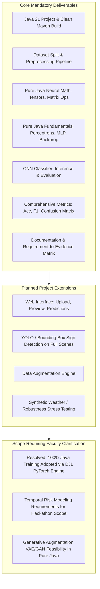

# Project Overview: Traffic Sign Recognition and Road Safety Monitor

**Course:** Deep Learning (CSAI3027P) — PBL & Hackathon  
**Language:** Java 21  
**Build System:** Apache Maven  
**Architecture:** Modular Deep Learning & Computer Vision System  

---

## 1. What is Traffic-Sign Recognition?

**Traffic-Sign Recognition (TSR)** is an automated computer-vision capability where a software system identifies and interprets visual traffic control devices—such as regulatory speed limits, cautionary yield markers, pedestrian warnings, and mandatory turn instructions—from digital camera images or video streams.

In human driving, a motorist glances ahead, spots an octagonal red patch, identifies the word "STOP", and connects that visual stimulus to the physical action of applying the vehicle brakes. In machine perception, TSR automates this translation:
1. Converting raw physical light into a numerical matrix of pixels (digital image).
2. Processing those numbers through mathematical functions (neural network).
3. Emitting a human-understandable categorization (e.g., `"Speed Limit 30 km/h"` with `94.2%` confidence).

---

## 2. Why Does This Problem Matter in Intelligent Transportation?

Traffic signs are the visual regulatory alphabet of civil roadways. In modern **Intelligent Transportation Systems (ITS)** and **Advanced Driver Assistance Systems (ADAS)**, reliable traffic-sign recognition provides critical real-time situational awareness:

* **Accident Reduction:** Missed or obscured warnings (e.g., blind curves, sharp turns, school zones) cause thousands of preventable collisions annually.
* **Speed Compliance:** Speed-limit detection alerts drivers when legal limits change dynamically (e.g., construction corridors or electronic overhead gantries).
* **Driver Workload Mitigation:** In poor visibility (heavy rainfall, night driving, optical glare), machine vision paired with contrast enhancement can perceive reflective sign geometry before human drivers notice it.
* **Autonomous Navigation Foundation:** Autonomous shuttles and delivery bots must obey local right-of-way rules defined purely by roadside signage without requiring continuous cloud or GPS connectivity.

---

## 3. Disambiguating Computer Vision and Deep Learning Tasks

A frequent source of confusion in computer vision projects is conflating different visual tasks. The table below delineates the four core paradigms addressed across the stages of this project:

| Task Paradigm | Question Answered | Traffic-Sign Context Example | Output Representation |
| :--- | :--- | :--- | :--- |
| **Image Classification** | *"What single sign is present in this cropped image?"* | Given a $32 \times 32$ pixel crop of a sign, determine if it is "Stop", "Yield", or "30 km/h". | A single class label vector: e.g., `Class 14 (Stop)`. |
| **Object Detection** | *"Where are the signs in this full road scene, and what are they?"* | Given a $1920 \times 1080$ windshield view, locate two speed signs and one pedestrian sign amidst cars, trees, and sky. | Bounding boxes $(x, y, w, h)$ + class labels + confidence scores. |
| **Semantic Segmentation** | *"Which exact pixels in the image belong to roadway, signage, vehicles, or background?"* | Delineating the exact pixel boundary of a circular sign face vs. the metal post vs. the foliage behind it. | A 2D pixel mask where every pixel $(i, j)$ has a category ID. |
| **Temporal Risk Modelling** | *"How is the risk evolving over time across successive video frames?"* | Observing a "Stop Ahead" sign at $t_0$, a "Crosswalk" at $t_1$, and vehicle deceleration at $t_2$ to estimate time-to-collision or violation risk. | A continuous risk index or alert sequence over a sliding temporal window $[t-k, \dots, t]$. |

---

## 4. Input Data Accepted by the Application

The application processes:
1. **Cropped Sign Images (Classification Pipeline):** Standardized resolution images ($32 \times 32$ or $48 \times 48$ RGB pixels) containing a single centered or slightly translated traffic sign (e.g., German Traffic Sign Recognition Benchmark / GTSRB format).
2. **Full Road Scene Images (Detection Pipeline):** Arbitrary resolution road scenes (e.g., $800 \times 600$ to $1920 \times 1080$ JPEG/PNG images from dashcams or dashboard mounts).
3. **Structured Image Metadata:** Format (JPEG, PNG), dimensions, color depth (8-bit per channel RGB), and channel order.

---

## 5. Output Produced by the Application

Upon processing an input image, the application provides:
1. **Predicted Class Label:** Human-readable name (e.g., `"Class 1: Speed limit (30km/h)"`).
2. **Confidence Metric:** Softmax probability score representing the model's categorical distribution.
3. **Bounding Boxes (when detection is active):** Pixel coordinates $[x_{min}, y_{min}, x_{max}, y_{max}]$ surrounding detected signs.
4. **Visual Annotated Artifact:** The original image overlaid with highlighted bounding boxes, class text, and confidence badges.
5. **Operational Warnings & Diagnostics:** Explicit feedback if:
   * The input image resolution is below operational thresholds.
   * Color contrast is degraded.
   * Model uncertainty exceeds the safety threshold ($\text{confidence} < \tau$).
   * The uploaded file format is unsupported.

---

## 6. How a Convolutional Neural Network (CNN) Learns Visual Patterns

Traditional Multi-Layer Perceptrons (MLPs) treat an image as a flat 1D array of independent numbers, completely discarding spatial layout (the fact that pixel $(x, y)$ is physically adjacent to $(x+1, y)$). A **Convolutional Neural Network (CNN)** preserves spatial geometry through three primary mathematical operations:

1. **Convolution (Feature Extraction):**
   A small learnable matrix of weights called a **kernel** or **filter** (e.g., $3 \times 3$ or $5 \times 5$) slides across the 2D image. At each position, it computes the element-wise dot product between the kernel and the underlying pixels:
   $$(I * K)(i, j) = \sum_{m} \sum_{n} I(i - m, j - n) K(m, n)$$
   * **Early Layers:** Kernels learn primitive edges, orientations, gradients, and color contrasts (e.g., detecting the red diagonal slash of a "No Entry" sign).
   * **Middle Layers:** Feature maps combine edges into geometric primitives: circles, octagons, triangles, and inner symbols (arrows, numbers).
   * **Deeper Layers:** High-level semantic features represent complete sign archetypes (e.g., circular red border with white horizontal bar).

2. **Non-Linear Activation (e.g., ReLU):**
   Calculates $f(x) = \max(0, x)$ to introduce non-linearity, allowing the network to approximate complex non-linear decision boundaries.

3. **Spatial Pooling / Downsampling (e.g., Max Pooling):**
   Slides a window (typically $2 \times 2$ with stride 2) and extracts the maximum value. This reduces dimensionality, decreases computation, and provides **translation invariance** (a Stop sign remains recognizable whether shifted 3 pixels left or right).

4. **Fully Connected Layers & Softmax:**
   Flattens high-level 2D feature maps into a 1D vector and computes final class log-probabilities through the Softmax function:
   $$\text{Softmax}(z_i) = \frac{e^{z_i}}{\sum_{j=1}^{C} e^{z_j}}$$

---

## 7. Deep Learning Workflow: Training, Validation, and Testing

To ensure the neural network generalizes to real-world roads rather than merely memorizing training pictures, the data is partitioned into three strictly isolated subsets:

1. **Training Set ($60\% - 70\%$):**
   The samples used directly by the optimization algorithm to compute gradients and adjust network weights and biases via backpropagation.
2. **Validation Set ($15\% - 20\%$):**
   Independent data evaluated after each training epoch to assess generalization, detect overfitting, and tune **hyperparameters** (such as learning rate, weight decay, or network depth). Model weights are never updated using validation samples.
3. **Test Set ($15\% - 20\%$):**
   Completely untouched, held-out data evaluated only once after final model selection to measure true unvarnished performance on novel road conditions.

---

## 8. Essential Deep-Learning Terminology Explained

Every fundamental term used throughout our codebase and experiments is defined below:

* **Loss Function:** A mathematical equation quantifying how far the network's prediction is from ground truth. For multi-class classification, we use **Categorical Cross-Entropy**:
  $$\mathcal{L}_{CE} = - \sum_{c=1}^C y_c \log(\hat{y}_c)$$
  If the true sign is "Yield" ($y_{\text{yield}} = 1$) but the model predicts $0.05$, the loss is large ($-\log(0.05) \approx 2.99$). If it predicts $0.98$, the loss is near zero ($-\log(0.98) \approx 0.02$).
* **Optimizer:** The mathematical algorithm updating the network weights to minimize the loss. Examples implemented and studied:
  * *Batch Gradient Descent (BGD):* Computes gradients over the entire dataset before updating.
  * *Stochastic Gradient Descent (SGD):* Updates weights using one sample at a time.
  * *Mini-batch SGD with Momentum:* Accumulates velocity vectors in directions of persistent gradient reduction to escape shallow local minima.
  * *Nesterov Accelerated Gradient (NAG):* Computes momentum updates with a look-ahead step.
  * *Adam (Adaptive Moment Estimation):* Maintains exponentially decaying averages of past gradients and squared gradients.
* **Epoch:** Exactly one complete pass of the entire training dataset through the neural network.
* **Batch Size:** The number of training examples processed in one forward and backward pass before weights are updated (e.g., 32, 64, or 128 samples).
* **Learning Rate ($\eta$ or $\alpha$):** A scalar multiplier dictating step size along the negative gradient:
  $$W \leftarrow W - \eta \nabla_W \mathcal{L}$$
  If too large, updates oscillate and diverge; if too small, training crawls or gets trapped in suboptimal plateaus.
* **Overfitting:** When a model memorizes idiosyncrasies, noise, or specific backgrounds of the training images (achieving $99\%$ training accuracy) but fails catastrophically on new road images ($60\%$ validation accuracy).
* **Data Augmentation:** Artificially expanding training data diversity using label-preserving transformations: slight rotations ($\pm 10^\circ$), brightness/contrast shifts, Gaussian noise, and perspective warping. This forces the network to learn invariant features rather than camera artifacts.
* **Inference:** The operational phase where a trained model with frozen parameters receives a new, unlabeled image and computes a forward pass to produce a prediction.

---

## 9. Confidence Scores vs. Calibrated Probabilities

The final layer of a classifier outputs values between 0.0 and 1.0 via Softmax. However:
> **A Softmax score is a relative ranking among known classes, NOT a calibrated probability of real-world correctness.**

* **The Overconfidence Problem:** Deep neural networks, especially when trained with cross-entropy, frequently output $98\%$ or $99\%$ confidence on out-of-distribution inputs (e.g., a blank gray image, a tree branch, or an animal on the road).
* **Mitigation Strategy in this Project:**
  1. We establish an explicit **rejection threshold** ($\tau = 0.60$): predictions below $\tau$ are rejected as `"Uncertain / Unclassified"`.
  2. We assess entropy of the output distribution: high entropy indicates ambiguity between competing signs.
  3. We document and test calibration using Expected Calibration Error (ECE) during evaluation.

---

## 10. How the Project Will Be Evaluated

Evaluation relies on rigorous, objective metrics across the held-out test split:

1. **Classification Accuracy:** Overall ratio of correctly identified signs across all classes.
2. **Per-Class Precision, Recall, and Macro-F1:**
   * *Precision:* When the model predicts "Stop", is it truly a Stop sign?
   * *Recall:* Out of all real Stop signs on the road, how many did the model detect?
   * *Macro-F1:* The unweighted harmonic mean across all classes, preventing majority classes from masking total failure on rare signs.
3. **Confusion Matrix:** A $C \times C$ matrix revealing systematic misclassifications (e.g., distinguishing "Speed limit 30" vs. "Speed limit 80").
4. **Detection Metrics (Stage 5):** Mean Average Precision (mAP@0.50 and mAP@0.50:0.95) and Intersection-over-Union (IoU) for bounding boxes.
5. **Inference Latency:** Milliseconds per frame on standard CPU hardware to evaluate real-time feasibility.
6. **Adversarial / Robustness Evaluation:** Performance under simulated weather corruptions: fog, low light, rain, and motion blur.

---

## 11. System Limitations and Safety Disclaimers

* **Academic Research Prototype:** This software is an educational prototype developed for course CSAI3027P. It has **NOT** undergone ISO 26262 functional safety certification.
* **No Autonomous Control:** Under no circumstances should this software be connected to vehicle actuators (steering, throttle, braking). It does not replace human observation.
* **Environmental Sensitivities:** Severe occlusion (foliage covering $>50\%$ of a sign), extreme night conditions without direct illumination, or lens distortion may cause missed detections or false classifications.
* **Regional Variation:** Models trained on European benchmarks (e.g., GTSRB) reflect Vienna Convention signage and will not generalize reliably to North American (MUTCD) or regional Asian sign standards without transfer learning.

---

## 12. Component Breakdown and Scope Classification

To ensure compliance with university guidelines and clear demarcation of deliverables, components are classified into three explicit tiers:

1. **Core Mandatory Deliverables (Non-negotiable for PBL):**
   * Pure Java 21 implementation of foundational mathematical routines (matrix operations, numerical gradient checking).
   * Pure Java 21 implementation of neural fundamentals (McCulloch-Pitts, Sigmoid, Multi-Layer Perceptrons, Backpropagation, BGD/SGD/Momentum/NAG).
   * Image loading, preprocessing, normalization, and dataset splitting without leakage.
   * Traffic-sign classification pipeline with reproducible metrics, confusion matrix, and latency logging.
   * Full documentation, viva preparation guides, and academic source logs.

2. **Planned Extensions (High-Value Enhancements):**
   * Responsive web interface for image upload, inference visualization, and real-time uncertainty alerts.
   * Object detection module (YOLO integration) for uncropped road scenes.
   * Automated robustness benchmark (rain, blur, lighting stress tests).

3. **Items Requiring Faculty Clarification:**
   * *Clarification Point 1 (RESOLVED):* The project strictly enforces a 100% Java implementation. Rather than seeking Python exceptions, model training is conducted directly from Java 21 using Deep Java Library (DJL) with PyTorch C++ native bindings.
   * *Clarification Point 2:* Is temporal sequence modeling (LSTM/GRU/Transformer) strictly expected for the hackathon prototype, or is frame-by-frame sliding window risk scoring sufficient?
   * *Clarification Point 3:* Generative data augmentation (VAE/GAN) — can this be treated as an offline comparative study?
