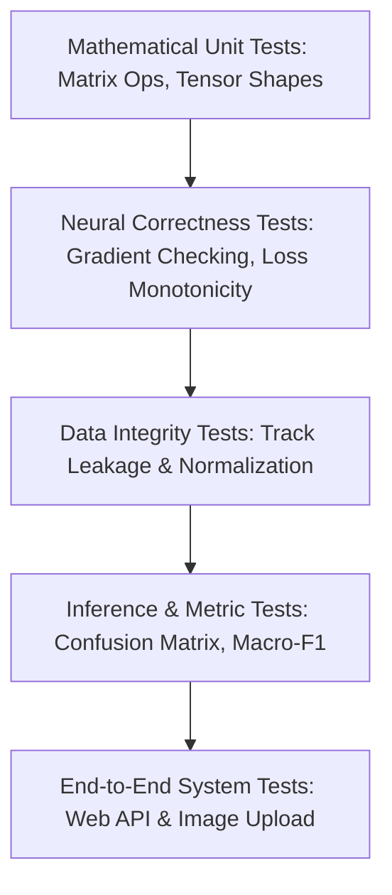

# Testing Strategy & Verification Protocol

**Project:** Traffic Sign Recognition and Road Safety Monitor  
**Language:** Java 21  
**Test Framework:** JUnit 5 (Jupiter) + AssertJ  

A deep learning project implemented in Java requires rigorous automated verification to ensure both mathematical correctness and software reliability. This document outlines the test architecture across all project stages.

---

## 1. Testing Pyramid for Java Deep Learning

---

## 2. Test Suites and Specifications

### A. Mathematical Operations Suite (`com.trafficsign.math`)
* **Matrix Arithmetic:**
  * Commutative properties of addition: $A + B = B + A$.
  * Associative properties of multiplication: $(AB)C = A(BC)$.
  * Transpose identity: $(A^T)^T = A$ and $(AB)^T = B^T A^T$.
  * Incompatible dimension exceptions: asserting that multiplying $(3 \times 4)$ by $(5 \times 2)$ throws `IllegalArgumentException`.
* **Tensor Shapes & Broadcasting:**
  * Reshaping $32 \times 32 \times 3$ into $1 \times 3072$ and reconstructing the identical tensor.
  * Vector-to-matrix bias broadcasting correctness.

### B. Neural Correctness & Gradient Checking (`com.trafficsign.neural`)
* **Neuron Truth Tables:**
  * `McCullochPittsNeuron`: Verified on truth tables for logical AND ($w_1=1, w_2=1, \theta=2$), OR ($w_1=1, w_2=1, \theta=1$), and NOT ($w_1=-1, \theta=0$).
* **Finite-Difference Gradient Checking:**
  * For every learnable parameter $\theta_i$, compute the two-sided numerical derivative:
    $$\nabla_{\text{num}} \mathcal{L}(\theta_i) = \frac{\mathcal{L}(\theta_i + \epsilon) - \mathcal{L}(\theta_i - \epsilon)}{2\epsilon}, \quad \epsilon = 10^{-5}$$
  * Compare against analytical backpropagation gradient $\nabla_{\text{anal}} \mathcal{L}(\theta_i)$ via the relative difference:
    $$\text{Relative Error} = \frac{\|\nabla_{\text{anal}} - \nabla_{\text{num}}\|_2}{\|\nabla_{\text{anal}}\|_2 + \|\nabla_{\text{num}}\|_2} < 10^{-6}$$
* **Loss Monotonicity on Overfitting Small Batches:**
  * Assert that a 2-layer MLP can overfit a synthetic 4-sample dataset to near-zero loss ($< 0.01$) within 100 iterations.

### C. Data Integrity & Leakage Prevention (`com.trafficsign.data`)
* **Zero Leakage Invariant:**
  * Given a list of GTSRB track IDs, assert that $\text{Tracks}_{\text{train}} \cap \text{Tracks}_{\text{val}} = \emptyset$ and $\text{Tracks}_{\text{train}} \cap \text{Tracks}_{\text{test}} = \emptyset$.
* **Normalization Bounds:**
  * Assert that all output pixel values strictly satisfy $0.0 \le x_{i,j,c} \le 1.0$.

### D. Evaluation & Metrics Suite (`com.trafficsign.evaluation`)
* **Confusion Matrix Consistency:**
  * Assert that $\sum_{i,j} M_{i,j} = N_{\text{samples}}$.
  * Assert that when off-diagonal elements are 0, Accuracy = Macro-Precision = Macro-Recall = 1.0.
* **Degenerate Edge Cases:**
  * Division-by-zero protection when a class has 0 true instances or 0 predictions (must return 0.0 without throwing `ArithmeticException`).

### E. End-to-End & Web Integration (`com.trafficsign.web`)
* **Input Validation:**
  * Assert rejection (HTTP 400) on unsupported file formats (`.exe`, `.pdf`, `.txt`).
  * Assert rejection (HTTP 413) on payloads exceeding size limits ($> 10 \text{ MB}$).
* **Inference Endpoint:**
  * Post a standard $32 \times 32$ PNG image; verify response contains valid class ID ($0 \le c < 43$), confidence score in $[0.0, 1.0]$, and latency $> 0\text{ms}$.
